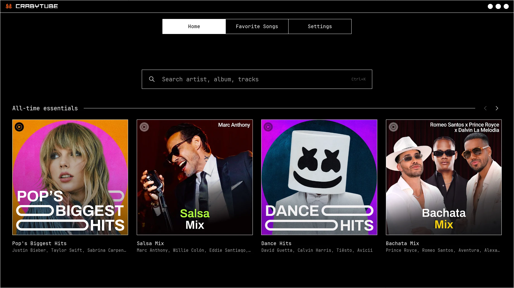
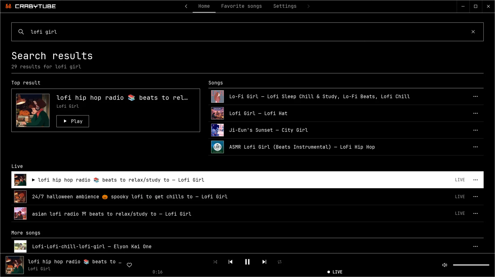
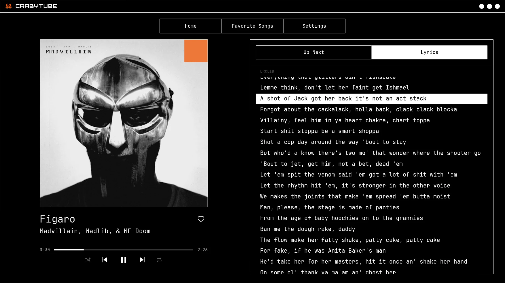
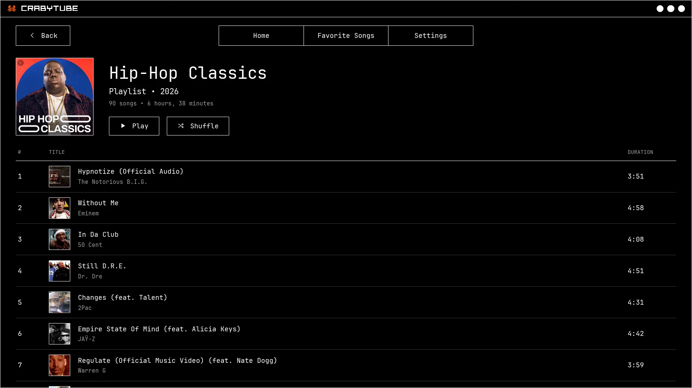

<p align="center">
  
</p>

<h1 align="center">CrabyTube</h1>

<p align="center">
  A lightweight, native YouTube Music player written in Rust.<br>
  No browser. No account. Just music.
</p>

<p align="center">
  
  
  
</p>

## Features

<table>
  <tr>
    <th width="33%" align="left"><code>01</code> LIGHTWEIGHT</th>
    <th width="33%" align="left"><code>02</code> NATIVE</th>
    <th width="33%" align="left"><code>03</code> NO ACCOUNT</th>
  </tr>
  <tr>
    <td valign="top">Under 100 MB of RAM while playing, a few dozen at rest. Idle CPU stays near zero.</td>
    <td valign="top">Pure Rust and Iced: no browser, no Electron. Opens fast and preloads the next track.</td>
    <td valign="top">Anonymous YouTube Music: no sign-in, cookies or telemetry. Your data stays local.</td>
  </tr>
  <tr>
    <th width="33%" align="left"><code>04</code> SYNCED LYRICS</th>
    <th width="33%" align="left"><code>05</code> BRUTALIST DESIGN</th>
    <th width="33%" align="left"><code>06</code> FITS YOUR DESKTOP</th>
  </tr>
  <tr>
    <td valign="top">Synced lyrics, plus word-by-word karaoke and translations for many popular songs.</td>
    <td valign="top">Pure black, monospaced type and one-pixel outlines. Scales from phone size to 4K.</td>
    <td valign="top">Media keys everywhere, a Linux tray icon, Discord Rich Presence and nine languages.</td>
  </tr>
</table>

## Screenshots

<table>
  <tr>
    <td width="50%"></td>
    <td width="50%"></td>
  </tr>
  <tr>
    <td width="50%"></td>
    <td width="50%"></td>
  </tr>
</table>

## Install

Each release on the GitHub Releases page has the packages for each platform. Nothing is signed
with a paid certificate, so your system asks you to confirm the first start once.

### Linux

Download the `.flatpak` file and install it for your user:

```bash
flatpak install --user CrabyTube.flatpak
```

If Flatpak asks for a runtime, allow it; it comes from Flathub. Then start CrabyTube from your
application menu.

The Flatpak has no access to your Documents folder, so Settings → Export and Import use
`~/.var/app/dev.holypanda.CrabyTube/data/crabytube-backup.json` instead.

### Windows

The installer is the easiest way, and the installed app updates itself:

1. Download `CrabyTube-<version>-windows-x64.msi` and open it. Windows SmartScreen may show
   "Windows protected your PC" because the package is not signed. Click **More info**, then
   **Run anyway**.
2. It installs CrabyTube for your user, without an administrator password, into
   `%LOCALAPPDATA%\Programs\CrabyTube`, adds it to the Start menu and opens it. To remove it, use
   **Settings → Apps → Installed apps**.

There is also a portable copy, which does not update itself:

1. Download `CrabyTube-windows-x64.zip` and extract it to a folder of your choice. Keep all the
   files together.
2. Run `CrabyTube.exe`. Confirm the SmartScreen warning once, as above.

Nothing else needs to be installed: the Visual C++ runtime is built into the executables.

### macOS

1. Download `CrabyTube-<version>-macos-universal.dmg`, open it and drag CrabyTube to
   Applications. (The `.zip` holds the same app: extract it and move `CrabyTube.app` to
   `/Applications`.) The app is universal and runs natively on Apple Silicon and Intel Macs.
2. The app is signed ad hoc and not notarized, so macOS blocks the first start. Allow it once:
   - On macOS 15 and later, double-click `CrabyTube.app` and click **Done** in the message that
     says it was not opened. Then open **System Settings → Privacy & Security**, scroll to
     **Security**, click **Open Anyway** next to the message about CrabyTube and confirm with your
     password or Touch ID. Control-click → **Open** no longer skips the warning there.
   - On macOS 14 and earlier, Control-click `CrabyTube.app`, choose **Open**, then **Open** again.
   - Or run this once in Terminal, then open the app normally:

     ```bash
     xattr -dr com.apple.quarantine /Applications/CrabyTube.app
     ```

   The disk image and the zip also contain a short first-launch note, the license and the
   third-party notices.

## Updates

On Windows and macOS, CrabyTube looks once a day for a newer version, and **Settings → Updates**
shows what it found and has **Check now**. The daily check can be turned off there.

- **Windows, installed with the `.msi`**: **Update now** downloads the new installer, closes
  CrabyTube, installs it and opens CrabyTube again.
- **macOS**: when CrabyTube was moved to a folder you can write to, such as Applications on an
  administrator account, **Update now** downloads the new version, puts it in place of the app and
  opens it again. Otherwise, as for an app opened straight from where it was unpacked, it opens the
  release page.
- **The Windows zip** does not update itself: **Download page** opens the release page. Extract the
  new zip over the old folder.
- **Linux**: the Flatpak does not check for updates. Install the new `.flatpak` the same way as the
  first one.

Settings, favorites, the queue and the history are kept apart from the app, so an update leaves
them as they are.

Every release carries `update.json`, which names the version and the size and SHA-256 of the
`.msi`, the Windows zip and the macOS zip, and its Ed25519 signature by the release key. CrabyTube
uses it only when the signature is right, and installs a download only when its size and SHA-256
match it, so a file that was changed, or a release someone else made, is never installed.
`SHA256SUMS` lists the SHA-256 of every package, the `.flatpak` and the `.dmg` included, for
checking a download by hand.

## Privacy

- No account and no login. CrabyTube uses YouTube Music anonymously and stores no credentials or
  cookies.
- No telemetry, analytics or crash reporting.
- Network requests go only to the services needed for the features you use: YouTube Music,
  YouTube and Google servers (catalog, artwork, audio and the BotGuard challenge), and the lyrics
  services LRCLIB and Better Lyrics (see below).
  Discord Rich Presence (off by default) talks only to the Discord client running on your computer.
- On Windows and macOS, the update check (on by default, Settings → Updates) downloads
  `update.json` and its signature from the latest release on GitHub once a day, and the new
  package when you choose to update. The requests carry the app's version in their user agent
  and nothing about you. The Flatpak makes no update requests.
- Lyrics come from two services. LRCLIB (lrclib.net) receives the track's title and artist. Better
  Lyrics (api.betterlyrics.org) receives the title, the artist and the duration when they are
  known, and the YouTube video ID; its QQ Music and Kugou lookups go through the same service.
  Without an API key it answers only for tracks it already holds, mostly popular songs.
  Lyrics are requested when the Lyrics tab is open, and also during the last 30 seconds of a track
  for the next track in the queue, so they are ready when that track starts. Fetched lyrics are
  cached on this computer for 30 days.
- The track that plays and the next one are downloaded to a temporary folder in the cache directory
  while they play. Files left behind by a crash are removed when CrabyTube starts, once they are old
  enough not to be in use.
- The `CRABYTUBE_NETWORK_DIAGNOSTICS` environment variable, meant for troubleshooting, makes the
  BotGuard helper send one request to `api64.ipify.org` each time it runs, and print only the address
  family and whether a proxy is set to its error output, never the address itself.
  It is off unless you set it.

## Translations

The interface is in nine languages: English, Spanish, Brazilian Portuguese, French, German, Italian,
Russian, Japanese and Simplified Chinese. It follows the system language on the first start and can
be changed in Settings. If a translation reads wrong in your language, an issue with the correction
is welcome.

## Disclaimer

CrabyTube is an unofficial client. It is not affiliated with, endorsed by, or sponsored by Google
or YouTube. YouTube and YouTube Music are trademarks of Google LLC; other trademarks belong to their
respective owners. CrabyTube is intended for personal use. It streams music for listening and has
no download feature; audio is only kept temporarily in the cache while it plays.

## License

CrabyTube is free software under the [GNU General Public License v3.0 or later](LICENSE).
Third-party code, assets and services are listed in [docs/licenses.md](docs/licenses.md).
Building from source is described in [docs/building.md](docs/building.md).
